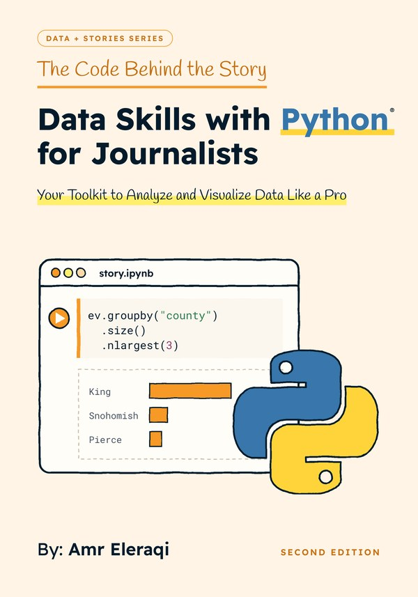

# The Code Behind the Story: Data Skills with Python for Journalists



Companion files for the second edition of *The Code Behind the Story: Data Skills with
Python for Journalists*, by Amr Eleraqi, part of the Data + Stories series.
Version of October 2026.

- Paperback: ISBN 9798309728350, [on Amazon](https://www.amazon.com/dp/B0DWKKD5F3)
- Hardcover: ISBN 9798309733132, [on Amazon](https://www.amazon.com/dp/B0DWG2DRKZ)
- Kindle edition, [on Amazon](https://www.amazon.com/dp/B0DY6L9Q6T)

## Read Chapter 1 free

[free-chapter-1.pdf](free-chapter-1.pdf) holds the opening of the book, the introduction
and "How to use this book", and the whole of Chapter 1, "Getting Started with Python and
Google Colab", with its exercises, their solutions and its sources. The pages are the
printed pages. The sample is free to read and to share as it is, without changes.

## The companion files

Everything in the book runs in Google Colab, in your browser, with nothing to install.
Each chapter shows how to bring its files into Colab, and this repository is where those
files live.

### The notebooks

Each notebook holds every code cell of its chapter, in the book's order, without the
explanations: the book explains each cell. Click a badge to open a copy of the notebook in
Colab, then run the cells from top to bottom. Typing the code yourself teaches more; the
notebooks help when you want to check a result or catch up after a missed step.

| Chapter | Notebook | |
|---|---|---|
| 1. Getting Started with Python and Google Colab | [`Chapter_01_Notebook.ipynb`](notebooks/Chapter_01_Notebook.ipynb) | [](https://colab.research.google.com/github/aeleraqi/Python-for-Journalists/blob/main/notebooks/Chapter_01_Notebook.ipynb) |
| 2. Data Collection Techniques | [`Chapter_02_Notebook.ipynb`](notebooks/Chapter_02_Notebook.ipynb) | [](https://colab.research.google.com/github/aeleraqi/Python-for-Journalists/blob/main/notebooks/Chapter_02_Notebook.ipynb) |
| 3. Data Cleaning and Preparation | [`Chapter_03_Notebook.ipynb`](notebooks/Chapter_03_Notebook.ipynb) | [](https://colab.research.google.com/github/aeleraqi/Python-for-Journalists/blob/main/notebooks/Chapter_03_Notebook.ipynb) |
| 4. Exploratory Data Analysis (EDA) | [`Chapter_04_Notebook.ipynb`](notebooks/Chapter_04_Notebook.ipynb) | [](https://colab.research.google.com/github/aeleraqi/Python-for-Journalists/blob/main/notebooks/Chapter_04_Notebook.ipynb) |

### The data files

Chapters 3 and 4 download their files from the `data` folder with a cell like this one:

```python
repo = ("https://raw.githubusercontent.com/"
        "aeleraqi/Python-for-Journalists/main")
!wget -q {repo}/data/Housing.csv
```

Change the name after `data/` to download any other file. Files in Colab's `/content`
folder are deleted when the session ends, so run the cell again when you come back.
Chapter 2 downloads its files from where they are published; copies are here for when a
source is out of reach.

### What is here

| Folder or file | What it holds |
|---|---|
| `notebooks/` | One Colab notebook for each chapter, with the code of the chapter in the order the chapter shows it. Cells that stop with an error on purpose are marked. |
| `data/` | The data files the book uses: the register of 150,482 electric vehicles (Chapter 3), the 545 house sales (Chapter 4) and the files of Chapter 2. [`data/README.md`](data/README.md) gives the source and license of each file. |
| `free-chapter-1.pdf` | A free sample of the book: the opening pages and all of Chapter 1. |
| `cover.jpg` | The front cover of the second edition. |
| `first-edition/` | The files that went with the first edition (2025): the Chapter 1 notebook, its exercises and a sample of Chapter 1. |

The code output in the book was produced in Google Colab in October 2026, with Python 3.13,
pandas 2.2.3, NumPy 2.1.3, Matplotlib 3.10.0 and seaborn 0.13.2. If your results differ,
check your versions first; section 1.12 of the book shows how. The code in this repository
is under the MIT License; each data file keeps the license of its source.
